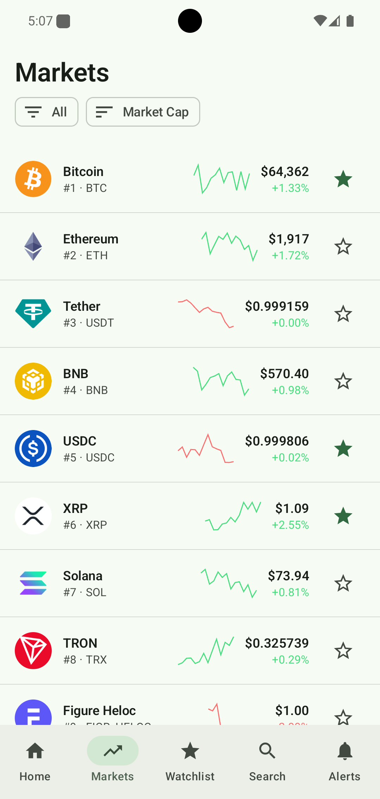
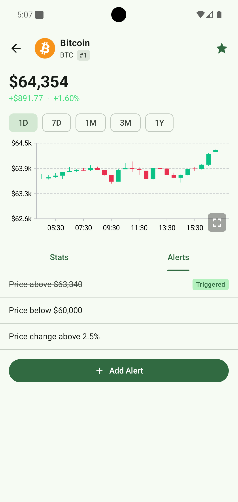
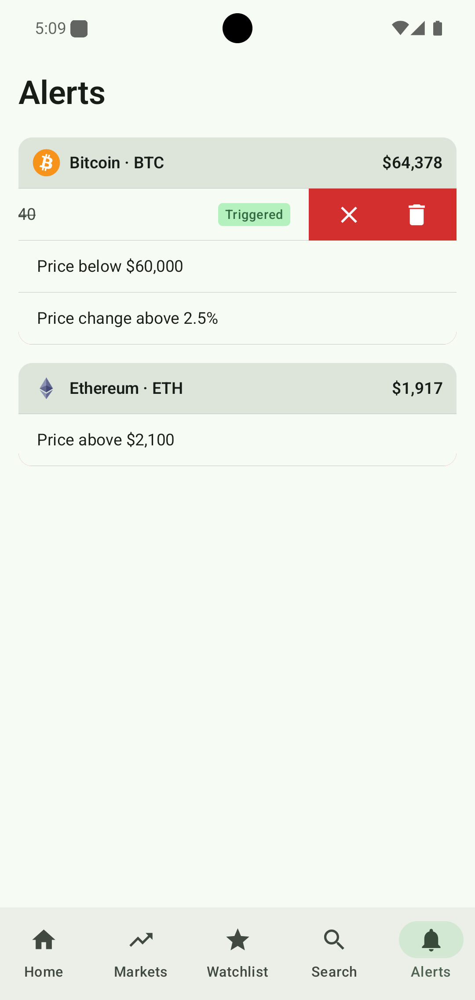

# Vela

Vela is a native Android app for following cryptocurrency markets. You can browse and search coins, keep a watchlist, view candlestick charts and set price or percentage-change alerts. Alerts are
checked in the background and arrive as notifications.

I built Vela on my own to work with current Android practice: Jetpack Compose, Clean Architecture with unidirectional data flow, Coroutines and Flow, WorkManager and automated testing at each layer.
Market data comes from the [CoinGecko API](https://www.coingecko.com/en/api). The app is not published on Google Play.

## Screenshots

<p align="center">
  
  
  
</p>

## Technical highlights

### One price source shared by every screen

The same coin's price arrives from several endpoints: the top list, market pages, coin detail and polling. Without a shared source, each screen could show a different value for the same coin. Every
successful response is written to a singleton `SimplePriceStore`. It's a `StateFlow` that maps coin ID to price and merges partial updates field by field, so a response without market cap doesn't
erase a value it already has. List rows subscribe to their own coin through `observePrice(id)` with `distinctUntilChanged()`. Each `PriceCell` collects only its own coin's flow, so a price
update recomposes that cell rather than the whole list.

Refreshing is handled in one place, `PricePolling`. Screens register the coin IDs they display. A single loop then fetches all of them in one batched `simple/price` request on a configurable interval.
The loop pauses when no screen is visible, so the app doesn't poll in the background for UI purposes.

### Price alerts that work with the app closed

Alerts are checked in three places, each with a different trigger:

- After every foreground poll, against the shared price store.
- In an in-process loop that runs while the app process is alive.
- In a periodic WorkManager job (`AlertCheckWorker`) that can check alerts when the app isn't open, subject to Android's background execution constraints. The job is injected with Hilt and runs only
  when the device has a network connection.

Price-target alerts are checked against 1-day OHLC candles recorded since the last check, not just the latest price. Checking candle highs and lows allows the app to detect price targets reached
between polling intervals, provided those movements are captured by the returned OHLC data.

Percentage alerts use the 24-hour change. Each triggered alert is marked in Room so it fires only once. Its notification carries a deep link that opens the coin's detail screen with that alert
selected.

Scheduling sits behind a domain `AlertCheckScheduler` interface. The evaluation logic lives in use cases (`RunAlertChecksUseCase`, `CheckAlertsByOhlcUseCase`, `AlertTriggerEvaluator`), so it's
unit-tested without WorkManager.

### Layered architecture with explicit UI state

- **Layers.** Dependencies point inward: `UI → domain ← data`. The domain layer defines models, repository interfaces and single-purpose use cases. The data layer implements those interfaces using
  Retrofit, Room and the price store. Hilt connects the layers.
- **UI state.** Each ViewModel exposes a `StateFlow` of a sealed UI state (loading, content or error).
- **Route and Screen.** Every screen is split into two composables. The Route owns the ViewModel, lifecycle and navigation. The Screen takes plain state and callbacks, so it can be previewed and
  UI-tested with fake data.
- **Refresh errors.** If a refresh fails while content is already on screen, the content stays and the error appears as a non-blocking banner.
- **Shared behaviour.** Watchlist toggling is used on several screens. It's provided by a delegated controller (`WatchlistController by …`) rather than a base ViewModel.

### Tests at each layer

- **Unit tests:** About 400, covering use cases, repositories, mappers, the price store and polling loop, deep-link handling and ViewModels. Written with JUnit 4, MockK, Turbine and
  `kotlinx-coroutines-test`.
- **Instrumented tests:** About 100, covering Compose screens, end-to-end navigation and deep-link flows, and Room DAOs. A custom `HiltTestRunner` uses `@TestInstallIn` to swap in fake repositories
  and an in-memory database.
- **Formatting:** A custom ktlint rule set (`ktlint-rules/`) enforces project formatting rules and has its own tests.

See [Testing and CI](#testing-and-ci) for how they run.

## Tech stack

| Area            | Libraries                                                                               |
|-----------------|-----------------------------------------------------------------------------------------|
| UI              | Jetpack Compose, Material 3, Navigation Compose (type-safe routes), Vico (charts), Coil |
| Architecture    | Hilt, AndroidX ViewModel and Lifecycle                                                  |
| Async           | Kotlin Coroutines, Flow and StateFlow, WorkManager                                      |
| Data            | Retrofit, OkHttp, Moshi, Room, Paging 3, kotlinx.serialization                          |
| Testing         | JUnit 4, MockK, Turbine, kotlinx-coroutines-test, Compose UI Test, Hilt testing         |
| Build & tooling | Gradle Kotlin DSL, version catalog, KSP, ktlint with custom rules, GitHub Actions       |

Kotlin 2.3 · AGP 9.2 · compileSdk and targetSdk 36 · minSdk 26

## Architecture

```
app/src/main/java/com/vela/
├── domain/   Models, repository interfaces, use cases, price store and scheduler contracts
├── data/     Repository implementations, Retrofit API, Room, price polling, WorkManager worker, Hilt modules
└── ui/       Compose screens and ViewModels, shared components and charts, navigation and deep links
```

The domain layer defines business logic and contracts without depending on the data or UI implementations. It uses framework-independent abstractions where practical, including Coroutines and Flow for
asynchronous operations and reactive data.

## Features

- **Home:** Top coins by market cap, with pull-to-refresh and live prices. The list is cached in Room and stays visible offline.
- **Markets:** A paginated list (Paging 3) sorted by market cap or volume, filterable by category, with 7-day sparklines.
- **Search:** Debounced search with empty and no-results states.
- **Watchlist:** Star a coin on any screen. Stored locally in Room.
- **Coin detail:** Candlestick charts for 1D, 7D, 1M, 3M and 1Y, a full-screen landscape chart, and market stats. A shared-element transition runs from list row to detail.
- **Alerts:** Price-target and percentage-change alerts with input validation, background checks, notifications and deep links.
- **Error handling:** Separate loading, empty, offline and server-error states with retry.

## Testing and CI

```bash
./gradlew test                       # unit tests
./gradlew connectedDebugAndroidTest  # instrumented tests (device or emulator required)
./gradlew ktlintCheck                # formatting, including the custom rules
```

A [GitHub Actions workflow](.github/workflows/dev-pr-approval.yml) runs three jobs on every pull request into `dev`: unit tests, instrumented tests on an API 35 Pixel 7 emulator, and ktlint.

## Getting started

Requirements: JDK 17, Android SDK 36, and an Android Studio version that supports AGP 9.2.

1. Clone the repository.
2. Add a CoinGecko Demo API key to `local.properties`, which is git-ignored. You can create a free key at [CoinGecko](https://www.coingecko.com/en/api):

   ```properties
   COINGECKO_API_KEY=<your-coingecko-demo-api-key>
   ```

3. Open the project in Android Studio, sync Gradle and run the `app` configuration.

## Further documentation

- [Architecture](docs/ARCHITECTURE.md): layer rules, price data flow, alert pipeline, deep links, caching and testing approach.
