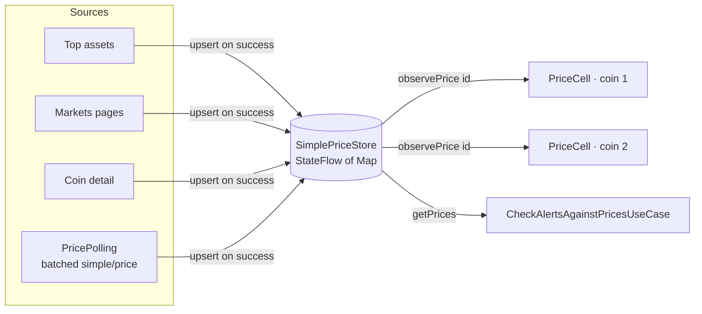
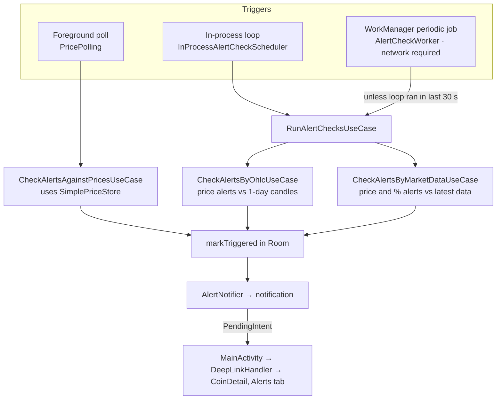

# Vela architecture

This document goes into more detail than the [README](../README.md). It covers the layer rules, how prices and alerts move through the app, and how the code is tested.

## Layers

```
ui      →  domain  ←  data
```

| Layer    | Contains                                                                                                                                  | Depends on                                                |
|----------|-------------------------------------------------------------------------------------------------------------------------------------------|-----------------------------------------------------------|
| `domain` | Models, repository interfaces, use cases, and contracts for `SimplePriceStore`, `PricePolling`, `AlertCheckScheduler` and `AlertNotifier` | Kotlin, Coroutines, `javax.inject`, Paging (`PagingData`) |
| `data`   | Repository implementations, Retrofit API, Room database, price store and polling implementations, WorkManager worker, Hilt modules        | `domain`                                                  |
| `ui`     | Compose screens, ViewModels, navigation, deep links, shared components                                                                    | `domain`                                                  |

Hilt binds each domain interface to its data implementation in `data/di`. ViewModels depend on use cases and domain interfaces, never on data classes, so tests can replace any dependency with a fake
or a MockK mock.

Results cross layers as `DataResult<T>` (`Success` or `Error`). Repository API operations use `safeApiCall {}` to translate network exceptions into `DataResult` and a sealed `AppError`:

- `IOException` becomes `NoInternet`.
- `HttpException` becomes `ServerError`.
- Anything else becomes `Unknown`.

The UI can then choose an error state without inspecting exceptions.

Paging requests handle failures separately through Paging's `LoadResult.Error`.

## UI layer

- **Route and Screen.** Each screen has a `…Route` composable and a `…Screen` composable. The Route gets the ViewModel through Hilt, collects state with `collectAsStateWithLifecycle`, reports
  visibility (`onScreenVisible`) and handles navigation. The Screen takes plain state and lambdas, so it works in `@Preview` and in Compose UI tests without Hilt.
- **State.** ViewModels expose `StateFlow` of a sealed UI state, such as `HomeUiState.Loading`, `Success` or `Error`. Some failures don't replace content: if a refresh fails while content is showing,
  the error goes into a `nonBlockingError` field on the success state and appears as a banner.
- **Navigation.** Navigation Compose uses type-safe `@Serializable` routes (`Screen.Dashboard`, `Screen.CoinDetail`). The dashboard holds five tabs: Home, Markets, Watchlist, Search and Alerts.
- **Shared behaviour.** Watchlist toggling is implemented once in `WatchlistControllerImpl`. ViewModels expose it through Kotlin delegation (`WatchlistController by watchlistController`) instead of
  inheriting from a base ViewModel.
- **Instant detail header.** `AssetPreviewCache` keeps the assets already loaded by the lists. The detail screen renders its header from this cache straight away while the full coin detail loads.

## Price data flow



**Problem.** Several endpoints return prices for the same coin. If each screen kept its own copy, the same coin could show different prices on different screens. If each ViewModel ran its own refresh
loop, the same coins would be requested several times.

**Approach.**

- `SimplePriceStore` is a singleton holding a `MutableStateFlow<Map<String, SimplePrice>>`. Repositories write to it after every successful fetch. Updates are merged field by field, so a response that
  omits a field (for example, market cap) keeps the existing value.
- `observePrice(id)` maps the shared flow to one coin and applies `distinctUntilChanged()`. Each `PriceCell` collects its own coin's flow using `collectAsStateWithLifecycle`, reducing unnecessary
  updates when other coins' prices change.
- `PricePolling` is a singleton that owns the only refresh loop. Screens and `AlertCoinRegistrar` register coin IDs. The loop fetches the union of all registered IDs in one `simple/price` request
  every `PricePollingConfig.refreshDelaySeconds`. A request is triggered right away only when new IDs are registered.
- The loop waits on `isScreenVisible.first { it }`, so it stops fetching while no screen is visible. Errors are published through a `SharedFlow<AppError?>`, which screens show as non-blocking banners.

## Alert pipeline



**Problem.** Alerts need checking while the app is open and after it closes. WorkManager's minimum period of 15 minutes is too slow on its own while the app is in use.

**Approach.** Three triggers share the same domain logic.

- **Foreground poll.** After each successful poll, `CheckAlertsAgainstPricesUseCase` checks active alerts against prices already in the store. This costs no extra request.
- **In-process loop.** `InProcessAlertCheckScheduler` starts when the process comes to the foreground and runs `RunAlertChecksUseCase` on a fixed interval while the process is alive. It writes a
  heartbeat to SharedPreferences each time it runs.
- **WorkManager job.** `WorkManagerAlertCheckScheduler` enqueues a unique, network-constrained periodic `AlertCheckWorker` (Hilt-injected). The worker skips its run if the heartbeat is less than 30
  seconds old. When a check fails, it returns `Result.retry()`. Execution is subject to Android's background scheduling constraints, so alert delivery is not guaranteed to be immediate.

**Evaluation.**

- `AlertTriggerEvaluator` compares the latest price (for price alerts) or 24-hour change (for percentage alerts) with the target.
- `CheckAlertsByOhlcUseCase` also checks price alerts against 1-day OHLC candles newer than the alert's last check. It uses candle highs for "above" alerts and lows for "below" alerts. A target
  reached and reversed between checks can still trigger, as long as the candle data captured it. If no candle triggers the alert, the use case stores the last candle timestamp so the next check starts
  from there.
- A triggered alert is marked in Room, so it leaves the active set and fires once.

**Scheduling contract.** Both schedulers implement the domain `AlertCheckScheduler` interface. The check logic lives in use cases with no WorkManager dependency, so it's unit-tested directly.

## Deep links

Notifications use an explicit, immutable `PendingIntent` targeting `MainActivity`, rather than a URI-based deep-link intent filter. The activity reads the intent extras and forwards the navigation
request through `DeepLinkHandler`.

1. `DeepLinkIntentFactory` writes the target (coin ID and optional alert ID) as intent extras.
2. `MainActivity` (`singleTop`) reads the extras in `onCreate` and `onNewIntent`, then sends a `DeepLink` to the singleton `DeepLinkHandler`, which is backed by a `Channel`.
3. The navigation host collects the channel and navigates to `Screen.CoinDetail` with the Alerts tab and the alert pre-selected.

Because the channel buffers events, a deep link sent before the navigation host is ready isn't lost.

## Persistence and caching

| Store                 | What it holds                                    | Why                                                                                            |
|-----------------------|--------------------------------------------------|------------------------------------------------------------------------------------------------|
| Room `assets`         | Home screen's top coins                          | The Home list renders from Room and stays visible offline; network refreshes replace the rows. |
| Room `watchlist`      | Starred coin IDs                                 | Local-only user data.                                                                          |
| Room `alerts`         | Alerts, triggered state, last OHLC check time    | Alerts must survive process death and be readable by the worker.                               |
| `AlertsCache`         | In-memory mirror of the `alerts` table           | Shares one Room observer across consumers and serves the current list without another query.   |
| `SimplePriceStore`    | Latest price per coin                            | See [Price data flow](#price-data-flow).                                                       |
| `AssetPreviewCache`   | Assets already shown in lists                    | Lets the detail header render immediately.                                                     |
| Paging 3 (`cachedIn`) | Markets pages (20 per page, prefetch distance 3) | Keeps loaded pages across configuration changes.                                               |

Room migrations are explicit (`MIGRATION_3_4`), and destructive fallback is turned off.

## Testing approach

| Level                            | Scope                                                                                                | Tools                                                           |
|----------------------------------|------------------------------------------------------------------------------------------------------|-----------------------------------------------------------------|
| Unit (`src/test`)                | Use cases, repositories, mappers, `SimplePriceStore`, `PricePolling`, deep-link handling, ViewModels | JUnit 4, MockK, Turbine, `kotlinx-coroutines-test`              |
| Instrumented (`src/androidTest`) | Compose screens, end-to-end navigation and deep-link flows, Room DAOs                                | Compose UI Test, Hilt testing                                   |
| Formatting                       | Project-specific formatting rules                                                                    | ktlint, custom rule set in `ktlint-rules/` (with its own tests) |

- **Test wiring.** Instrumented tests run through a custom `HiltTestRunner`. `@TestInstallIn` replaces `RepositoryModule` with fake repositories and `DatabaseModule` with an in-memory Room database.
  Screens therefore run against deterministic data, with no network.
- **Stable selectors.** UI tests find elements through shared test tags (`TestTags`) rather than displayed text.
- **Previews.** Fake data sources in `data/source/fake/` back the Compose previews only.
- **CI.** Every pull request into `dev` runs all three levels in GitHub Actions. Instrumented tests run on an API 35 emulator.
